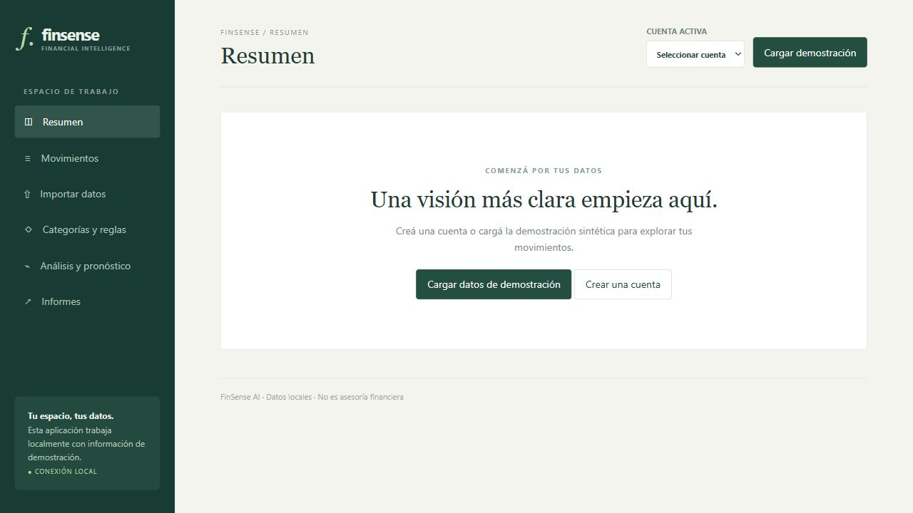

# FinSense AI

Prototipo funcional de análisis financiero local para un portafolio. Importa datos sintéticos, organiza transacciones por cuenta y moneda, calcula ingresos, gastos y balance neto, identifica gastos inusuales y pronostica gastos mensuales con ML.NET. No es un banco ni asesor financiero; no se conecta a bancos ni mueve dinero.



**Estado: trabajo en curso.** Se implementaron y verificaron componentes reales, pero aún faltan criterios funcionales indicados más abajo. No se generó ni verificó un archivo Power BI `.pbix`.

## Tecnología y arquitectura

ASP.NET Core 10 y C# sirven una interfaz HTML/CSS/JS. EF Core 10 usa SQL Server y migraciones; `decimal(18,2)` almacena dinero. CSVHelper valida CSV; Python 3.11 genera los datos sintéticos; ML.NET TimeSeries 4.0.2 entrena un modelo SSA local. La base `FinSenseAI_Dev` es independiente. La interfaz usa verde oscuro, verde salvia y tonos neutros; se usan tipos del sistema si no hay fuentes externas.

## Ejecutar en Windows

Requiere .NET SDK 10, Python 3.11 y SQL Server Express accesible con autenticación de Windows. El servidor predeterminado es `.\SQLEXPRESS`; también puede utilizarse otra instancia configurando `ConnectionStrings__Finance`. No se guardan credenciales reales en el repositorio.

```powershell
cd "$env:USERPROFILE\Desktop\6sixP\FinSense AI"
dotnet restore FinSense
dotnet tool restore
dotnet ef database update --project FinSense
dotnet run --project FinSense --no-launch-profile --urls http://127.0.0.1:5185
```

Abrí http://127.0.0.1:5185/. En otra instancia, configurá por ejemplo una variable de entorno antes de migrar y ejecutar:

```powershell
$env:ConnectionStrings__Finance='Server=SERVIDOR;Database=FinSenseAI_Dev;Trusted_Connection=True;TrustServerCertificate=True'
```

La migración crea la base si no existe; no borra ninguna base. No apuntés el nombre de la base de demostración a datos existentes. `TrustServerCertificate` es una configuración para desarrollo local, no para producción.

## Demostración y CSV

Pulsá **Cargar demostración**: crea una cuenta CRC, categorías y 150 movimientos sintéticos de 30 meses. La acción evita duplicar la cuenta de demostración. `python scripts/generate_demo.py` regenera el CSV con semilla 42 y meses relativos a la fecha actual; el archivo se genera en `FinSense/examples/demo.csv`. El botón de descarga es una copia en `FinSense/wwwroot/demo.csv`; actualizá esa copia tras regenerar el ejemplo. Contiene salario, alquiler, alimentación y transporte, además de un gasto de supermercado intencionalmente alto. No contiene datos reales.

Formato UTF-8, separado por comas; fechas `AAAA-MM-DD`, montos positivos con punto decimal y hasta dos decimales, 5 MiB y 10.000 filas como máximo. Columnas obligatorias: `fecha,descripcion,tipo,monto`; opcionales `categoria,referencia`. Tipos: `ingreso` y `gasto`. Cada categoría debe existir y corresponder al tipo. La pantalla de importación muestra una vista previa antes de confirmar. Identifica como posibles duplicados referencias iguales o, sin referencia, fecha/tipo/monto/descripción iguales dentro de la cuenta; los omite por defecto, pues podrían representar dos operaciones reales. La confirmación revalida el archivo y usa una transacción SQL. Se guardan el nombre del archivo y los conteos, no el archivo original. Se aceptan filas válidas aunque otras se rechacen; el detalle de rechazos se muestra en la vista previa, pero aún no se guarda de forma permanente.

## Uso y metodología

- Seleccioná una cuenta. El resumen suma únicamente movimientos activos de esa cuenta: ingresos menos gastos es el **balance neto del período**, no el saldo real de una cuenta bancaria.
- Filtrá movimientos por fechas, descripción y tipo; creá o editá movimientos y anulalos con confirmación. Las anulaciones no afectan los indicadores. La exportación CSV identifica su estado y protege los textos que comienzan con `=`, `+`, `-`, `@`, tabulador o retorno mediante un apóstrofo.
- Creá categorías y reglas de texto exacto o contenido. La menor prioridad numérica gana y, en empate, la regla con menor ID. Se aplican al importar filas sin categoría explícita; la categoría corregida manualmente no se cambia automáticamente. Se pueden probar las reglas activas desde la interfaz.
- Un gasto se señala si supera dos veces la mediana de al menos cinco gastos anteriores de la misma categoría en la misma cuenta. No implica fraude.
- El pronóstico SSA usa gastos mensuales de una sola cuenta, excluye movimientos anulados y el mes actual incompleto. Exige 24 meses; meses sin registros se interpretan como cero, lo cual puede ser incorrecto si falta historial. Predice un mes; evalúa los últimos tres meses mediante entrenamiento temporal progresivo y compara MAE en moneda con el último mes observado. Predicciones negativas se limitan a cero. La estimación no es transacción real ni garantía.
- Informes permite descargar un HTML de totales y gastos por categoría, y un CSV para Power BI. Véase `POWER-BI.md` para los pasos y medidas DAX.

## Pruebas

```powershell
dotnet test FinSense.Tests
python -m venv .venv
.\.venv\Scripts\python.exe -m pip install pytest
.\.venv\Scripts\python.exe -m pytest -q
node --check FinSense/wwwroot/app.js
```

El flujo local de GitHub Actions está preparado pero no publicado ni ejecutado en GitHub. Las pruebas de lógica no sustituyen la integración con SQL Server. La migración y el recorrido de demostración/pronóstico sí se verificaron contra SQL Server Express local. Power BI Desktop no fue verificado.

## Privacidad

El flujo principal se ejecuta localmente, sin IA generativa ni envío de transacciones a servicios de terceros. No hay autenticación ni cifrado de base: cualquiera con acceso a la app o base puede ver datos. No usar con información financiera real ni exponer a Internet. La exportación protege fórmulas en campos textuales, pero debe tratarse como información sensible. La eliminación segura de datos y el aislamiento entre usuarios no están implementados.

## Pendientes y limitaciones

- Administración visual completa de cuentas, categorías y reglas: no existen controles para editar/desactivar cuentas, editar categorías o editar/desactivar reglas, aunque hay endpoints de edición de cuenta y regla. Tampoco hay vista previa para aplicar reglas a movimientos ya importados.
- Filtros de categoría, ordenamiento y detalle completo de movimientos todavía no están disponibles en la interfaz; el backend ofrece una parte de estos filtros.
- El CSV de informes no incorpora todos los filtros del explorador.
- Falta un procedimiento específico de eliminación idempotente de datos sintéticos; no borres la base para reiniciar la demo si contiene información que quieras conservar.
- El histórico del pronóstico se calcula y devuelve en la API, pero aún falta visualizarlo en la pantalla de análisis. El entrenamiento ocurre al abrir esa pantalla y no se persiste como modelo.
- La revisión visual y de accesibilidad no cubre todos los estados; faltan pruebas integrales de importación, edición, monedas y modelo, y la integración completa automatizada con SQL Server. No existe archivo PBIX verificado.
- La base no tiene restricciones SQL exhaustivas para todas las validaciones de negocio. La bitácora registra edición/anulación, sin valores anteriores. No hay garantía de borrar datos de respaldos.

## Solución de problemas

Si el puerto 5185 está ocupado, elegí otro en `--urls`. Si la base no responde, verificá el servicio SQL Server Express, autenticación y cadena de conexión; ejecutá la migración. Si ML.NET indica datos insuficientes, cargá al menos 24 meses completos de gastos. Para detener, usá Ctrl+C.

## Recorrido para entrevista

Mostrá la cuenta y los montos separados por moneda, la vista previa de importación, las reglas basadas en texto, el señalamiento estadístico, el pronóstico con MAE frente a la línea base y la exportación Power BI. Explicá por qué no se considera asesoría financiera y cuáles son los puntos pendientes.
